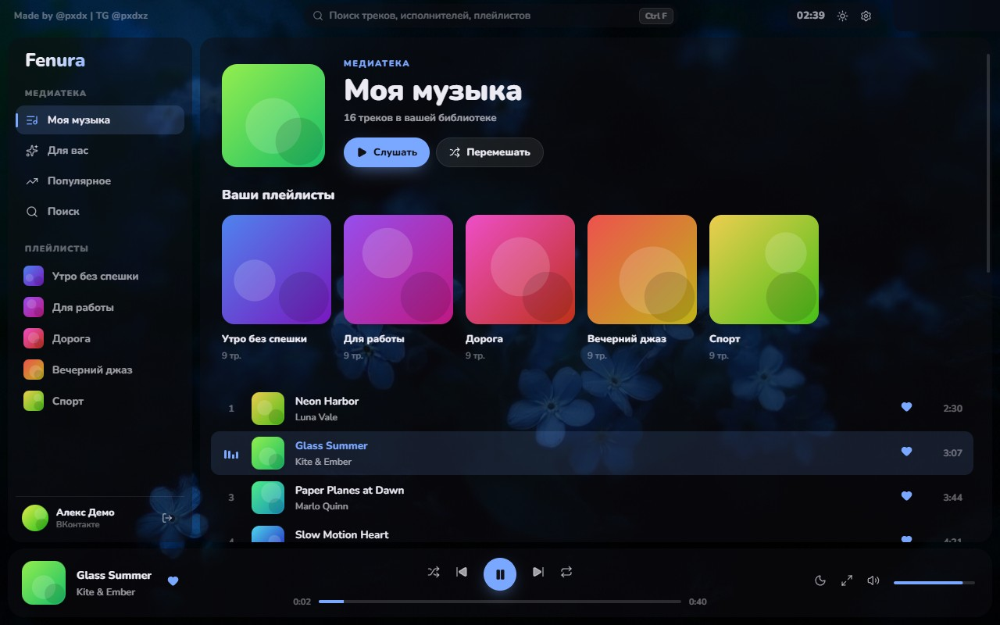
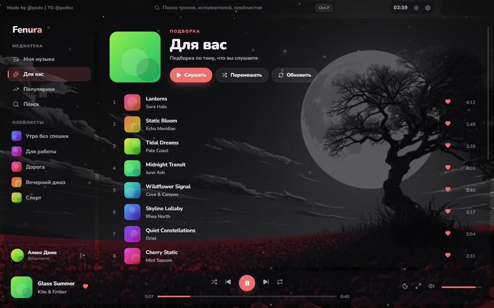
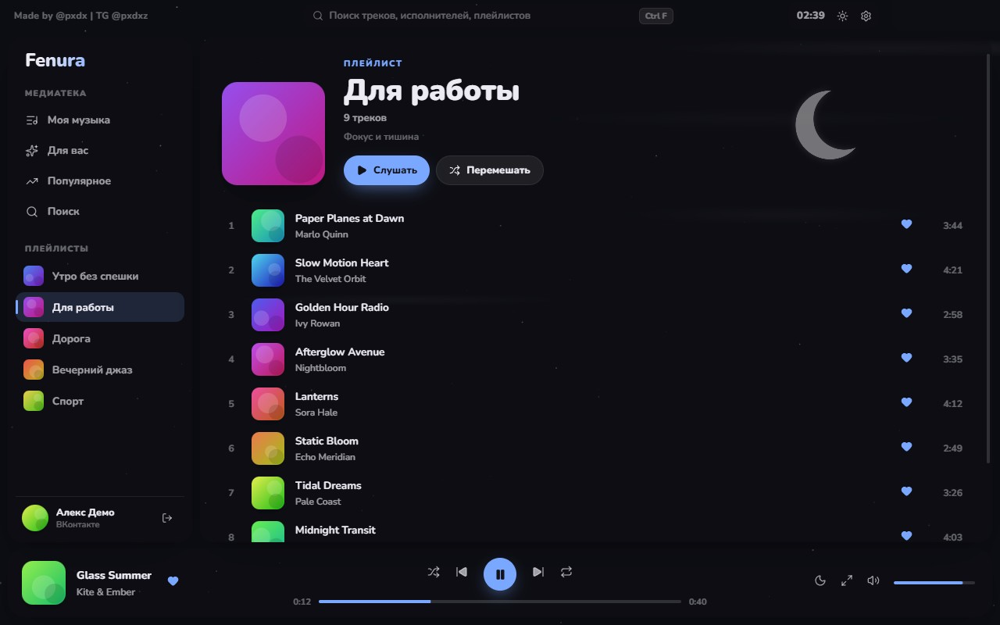
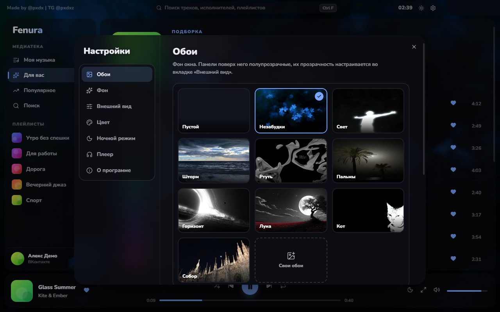
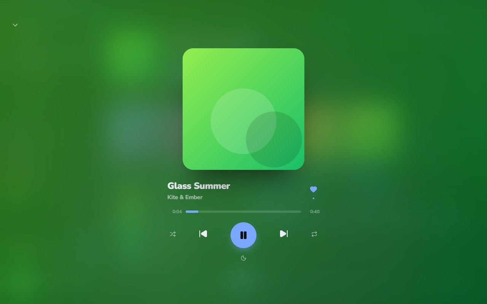

<div align="center">


# Fenura

**Музыкальный плеер для ВКонтакте на Windows**

Ваша музыка, плейлисты и рекомендации в одном красивом окне.<br>
Обои, матовое стекло, живой фон и ночной режим — спокойно для глаз даже ночью.

[](https://github.com/pxdxx/Fenura-vkmusic/releases/latest)
[](LICENSE)
[](#скачать)
[](https://github.com/pxdxx/Fenura-vkmusic/actions/workflows/build.yml)

[](https://github.com/pxdxx/Fenura-vkmusic/releases)
[](https://github.com/pxdxx/Fenura-vkmusic/stargazers)

<a href="https://github.com/pxdxx/Fenura-vkmusic/releases/latest/download/Fenura-Setup.exe">
  
</a>

[Возможности](#возможности) · [Скачать](#скачать) · [Сборка](#сборка-из-исходников) · [Ограничения](#ограничения)

</div>

<p align="center">
  
</p>

<p align="center">
  
  
</p>

<p align="center">
  
  
</p>

## Возможности

- **Вся музыка ВКонтакте:** моя музыка, плейлисты, поиск, «Для вас» и «Популярное». Вход через страницу ВК, пароль приложение не видит.
- **Обои и матовое стекло.** 9 встроенных обоев, пустой фон или своя картинка. Затемнение, размытие и прозрачность панелей настраиваются.
- **Живой фон:** звёзды, созвездия, звездопад, снег, дождь, светлячки и луна.
- **Ночной режим:** тёмная тема по расписанию и тёплый фильтр, который убирает синий свет.
- **Сейчас играет** на весь экран, **таймер сна** и плавная пауза.
- **Акцентный цвет** от обоев, из обложки трека или свой.
- Медиа-клавиши и панель громкости Windows, горячие клавиши, лёгкий расход ресурсов.

## Скачать

| Система | Файл |
| --- | --- |
| Windows 10 и 11, 64 бита | [`Fenura-Setup.exe`](https://github.com/pxdxx/Fenura-vkmusic/releases/latest/download/Fenura-Setup.exe) |

1. Запустите `Fenura-Setup.exe` и выберите папку установки.
2. Установщик не подписан, поэтому SmartScreen может показать «Система Windows защитила ваш компьютер». Нажмите **«Подробнее»**, затем **«Выполнить в любом случае»**.
3. Войдите во ВКонтакте в открывшемся окне — библиотека загрузится сама.

### Горячие клавиши

| Действие | Клавиши |
| --- | --- |
| Играть / пауза | `Пробел` |
| Следующий / предыдущий | `Ctrl` + `→` / `←` |
| Громкость | `Ctrl` + `↑` / `↓` |
| Поиск | `Ctrl` + `F` |
| Сейчас играет | `Ctrl` + `P` |
| Настройки | `Ctrl` + `,` |

## Сборка из исходников

Нужен [Node.js](https://nodejs.org/) 22 или новее.

```bash
npm install
npm start          # запуск
npm run demo       # демо без ВКонтакте, с вымышленными треками
npm test           # тесты
npm run dist       # установщик в dist/
```

## Ограничения

- Fenura — **плеер, а не загрузчик**: треки только воспроизводятся потоком.
- Это **неофициальный клиент**, он не связан с ВКонтакте. Если ВК изменит способ отдачи музыки, понадобится обновление.
- Токен и куки хранятся только на вашем компьютере (защищённое хранилище Windows), выход из аккаунта их удаляет.

## Связь

- Telegram: [@pxdxz](https://t.me/pxdxz)
- Нашли ошибку — откройте [issue](https://github.com/pxdxx/Fenura-vkmusic/issues).

## Лицензия

[MIT](LICENSE) © 2026 pxdxx
